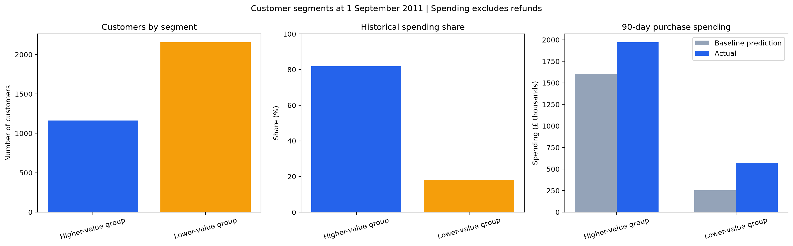

# Customer Segmentation & 90-Day Value Prediction

An analysis of retail purchase records to identify customer groups, estimate spending over the next 90 days, and support retention planning.

The project combines RFM analysis, K-Means clustering, chronological prediction, and a Streamlit dashboard. A previous-spending baseline outperformed both XGBoost experiments and was selected for the dashboard.

**[Open the dashboard](https://customer-segmentation-90-day-value-prediction-3ewip6j4hjbpcsmx.streamlit.app/)**



## Business Questions

- Which customers contribute most to purchase spending?
- Which customers buy less frequently or have not purchased recently?
- How well can historical behaviour predict the next 90 days of spending?
- Where should the business investigate retention and reactivation opportunities?

## Key Results

| Measure | Result |
|---|---:|
| Original transaction records | 541,909 |
| Purchase records retained after cleaning | 392,692 |
| Customers across the cleaned purchase dataset | 4,338 |
| Customers known at the September evaluation cutoff | 3,317 |
| Selected customer groups | 2 |
| Sampled silhouette score | 0.4493 |
| Selected baseline MAE | £565.05 |
| Updated XGBoost MAE | £576.40 |
| Historical spending contributed by the higher-value group | 81.9% |
| Share of total absolute error from the 10 largest errors | 19.7% |

**Main finding:** approximately 35% of customers accounted for 81.9% of historical purchase spending.

All spending figures are in GBP and exclude refunds. They represent purchase spending, not profit or net revenue.

## Dataset

Source: [UCI Online Retail](https://archive.ics.uci.edu/dataset/352/online+retail)  
Dataset DOI: [10.24432/C5BW33](https://doi.org/10.24432/C5BW33)

The dataset contains purchases from a UK-based online retailer between **1 December 2010 and 9 December 2011**.

Each row represents a product line on an invoice. Multiple product rows can therefore belong to the same purchase.

| Column | Description |
|---|---|
| `InvoiceNo` | Invoice identifier; a prefix of `C` indicates cancellation |
| `StockCode` | Product identifier |
| `Description` | Product description |
| `Quantity` | Number of units |
| `InvoiceDate` | Transaction date and time |
| `UnitPrice` | Price per unit in GBP |
| `CustomerID` | Customer identifier |
| `Country` | Customer country |

## Data Preparation

The original dataframe was preserved while separate working tables were created for customer analysis.

| Preparation stage | Rows remaining |
|---|---:|
| Original dataset | 541,909 |
| Exclude 135,080 rows without a customer ID | 406,829 |
| Remove 5,225 exact repeated occurrences | 401,604 |
| Separate 8,912 cancellation or non-positive quantity/price rows | 392,692 |

The records after deduplication included:

- 8,872 cancellation rows.
- 8,872 negative-quantity rows.
- No zero-quantity rows.
- 40 rows with zero or negative prices.

Cancellation and other adjustment rows were retained separately in the notebook, rather than discarded from the working analysis entirely.

Purchase line amounts were calculated as:

```python
LineAmount = Quantity * UnitPrice
```

Exact duplicate removal is a documented assumption: the available fields cannot establish whether every identical record was an accidental duplicate or a genuine repeated product line.

## Customer Features

Features were calculated using only purchases before each snapshot cutoff.

| Feature | Definition |
|---|---|
| `Recency` | Calendar days since the customer's latest purchase |
| `Frequency` | Number of distinct purchase invoices |
| `Monetary` | Total historical purchase spending |
| `SpendLast90Days` | Purchase spending during the 90 days before the cutoff |

Frequency counts distinct invoices, not product rows.

`ActualSpend90Days` is the prediction target: the customer's recorded purchase spending during the following 90 days. Existing customers with no recorded purchases in that window receive a target of zero.

Customer IDs and future spending were excluded from model inputs.

## Customer Segmentation

The segmentation workflow used:

1. Historical Recency, Frequency, and Monetary features.
2. `numpy.log1p` to reduce skew.
3. `StandardScaler` to put features on comparable scales.
4. K-Means with 2–6 clusters.
5. Sampled silhouette scores and interpretation of customer profiles.

K-Means used `random_state=42` and `n_init=10`. Silhouette scores were calculated on a reproducible sample of 1,500 customers.

### Cluster Comparison

| Number of clusters | Silhouette score |
|---|---:|
| **2** | **0.4493** |
| 3 | 0.3486 |
| 4 | 0.3605 |
| 5 | 0.3207 |
| 6 | 0.3112 |

Two clusters had the highest score among the configurations tested.

### Segment Profiles

Profiles refer to purchases before **1 September 2011**.

| Measure | Higher-value / more frequent group | Lower-value / less frequent group |
|---|---:|---:|
| Customers | 1,163 | 2,154 |
| Share of customers | 35.1% | 64.9% |
| Median recency | 23 days | 114 days |
| Median frequency | 5 invoices | 1 invoice |
| Median historical spending | £1,737.70 | £321.61 |
| Total historical spending | £4,281,131.55 | £946,348.64 |
| Share of historical spending | 81.9% | 18.1% |

Segment names describe group tendencies. Membership does not mean that every customer in the higher-value group is currently active.

## 90-Day Spending Prediction

### Chronological Design

An earlier customer snapshot was used for training and a later snapshot for evaluation.

| Snapshot | Historical features | Future spending target | Customers |
|---|---|---|---:|
| Training | Purchases before 1 June 2011 | 1 June–29 August 2011 | 2,718 |
| Evaluation | Purchases before 1 September 2011 | 1 September–29 November 2011 | 3,317 |

Both target windows cover exactly 90 days, with exclusive end dates of **30 August** and **30 November**, respectively.

Only customers already known before each cutoff were included. The same customer may appear in both snapshots, reflecting prediction of future spending for existing customers.

### Baseline

The baseline predicts:

```text
Next 90-day spending = Previous 90-day spending
```

It provides a simple benchmark against which to assess the machine-learning models.

### XGBoost Experiments

Two feature sets were evaluated:

- **Initial:** Recency, Frequency, Monetary.
- **Updated:** Recency, Frequency, Monetary, SpendLast90Days.

Both used the same model settings:

```python
XGBRegressor(
    objective="reg:squarederror",
    n_estimators=200,
    max_depth=3,
    learning_rate=0.05,
    subsample=0.8,
    colsample_bytree=1.0,
    random_state=42,
    n_jobs=2
)
```

Negative model predictions were clipped to zero because the target is non-negative purchase spending.

### Prediction Results

| Approach | MAE | MAE relative to baseline |
|---|---:|---:|
| **Previous 90-day spending baseline** | **£565.05** | Reference |
| XGBoost using RFM | £597.58 | 5.76% higher |
| XGBoost using RFM and recent spending | £576.40 | 2.01% higher |

**Lower MAE is better.** MAE measures average absolute prediction error per customer in pounds; it is not percentage accuracy.

Adding recent spending reduced XGBoost's error, but the baseline remained the best-performing approach in this comparison. The dashboard therefore displays baseline predictions. The saved XGBoost model is retained as a comparison model.

**Evaluation qualification:** the September results were inspected before adding the recent-spending feature. The updated result is an exploratory comparison, not performance on an untouched final test set.

## Error Analysis

The 10 customers with the largest absolute errors contributed **19.7% of total absolute error**.

This shows that large spending changes among a small number of customers materially affect the overall error.

| Segment | Predicted 90-day spending | Actual 90-day spending | Customer-level MAE |
|---|---:|---:|---:|
| Higher-value / more frequent group | £1,605,931.64 | £1,969,558.14 | £1,091.77 |
| Lower-value / less frequent group | £253,669.05 | £572,499.04 | £280.66 |

The baseline underpredicted aggregate spending in both groups. The higher-value group also had larger average errors in pounds.

## Business Interpretation

### Higher-value / more frequent group

This group contains approximately one-third of customers and contributes most historical purchase spending.

Suggested actions:

- Prioritise service quality and retention attention.
- Review high-value customers whose purchase activity has declined.
- Investigate unusually large accounts individually when forecasts change substantially.

### Lower-value / less frequent group

This group has lower historical spending and a longer median time since purchase.

Suggested actions:

- Investigate differences between one-time buyers and previously repeat buyers.
- Test a targeted reactivation campaign against a control group.
- Measure incremental spending and campaign cost before expanding the campaign.

These are recommendations for further investigation. The project does not demonstrate campaign uplift, retention improvement, or increased profit.

## Streamlit Dashboard

The dashboard contains three tabs:

| Tab | Features |
|---|---|
| **Segment overview** | Customer counts, historical spending shares, predicted versus actual spending, and suggested actions |
| **Customer explorer** | Segment filtering, customer ID search, customer-level results, and CSV download |
| **Method & limitations** | Modelling summary, baseline comparison, and evaluation limitations |

The app reads exported analysis results. It does not retrain models, accept new transaction uploads, or generate current forecasts.

## Technology

| Component | Tools |
|---|---|
| Data preparation and feature calculations | Python, pandas, NumPy |
| Scaling, clustering, and evaluation | scikit-learn |
| Spending regression experiments | XGBoost |
| Notebook charts | Matplotlib |
| Dashboard | Streamlit |
| Saved clustering objects | joblib |
| Analysis environment | Jupyter Notebook |

## Repository Files

| Path | Purpose |
|---|---|
| `customer_segmentation.ipynb` | Data preparation, segmentation, prediction experiments, and analysis |
| `app.py` | Streamlit dashboard |
| `requirements.txt` | Dashboard dependencies |
| `project_outputs/customer_results.csv` | Customer features, segments, predictions, actual spending, and errors |
| `project_outputs/segment_summary.csv` | Segment-level business summary |
| `project_outputs/cluster_scores.csv` | Silhouette scores for candidate cluster counts |
| `project_outputs/customer_summary.png` | Exported summary charts |
| `project_outputs/project_metadata.json` | Selected method, metrics, dates, and limitations |
| `project_outputs/segmentation_model.joblib` | Fitted scaler, K-Means model, feature order, and segment names |
| `project_outputs/xgboost_comparison.json` | Updated fitted XGBoost comparison model |

## Run the Dashboard Locally

Clone the repository and enter its directory:

```bash
git clone https://github.com/PriyanshuSharmapixel/Customer-Segmentation-90-day-value-prediction.git
cd Customer-Segmentation-90-day-value-prediction
```

Install the dashboard dependencies:

```bash
python -m pip install -r requirements.txt
```

Start the app:

```bash
python -m streamlit run app.py
```

Keep `project_outputs` beside `app.py`, including the customer results, segment summary, and metadata files.

The dashboard uses saved CSV and JSON files, so XGBoost and scikit-learn are not required just to view it.

## Reproduce the Notebook

Install the additional analysis dependencies:

```bash
python -m pip install numpy pandas scikit-learn xgboost matplotlib openpyxl joblib jupyter ucimlrepo
```

Then:

1. Download `Online Retail.xlsx` from the UCI dataset page.
2. Open `customer_segmentation.ipynb`.
3. Replace the Windows-specific Excel path in the `pd.read_excel()` cell with your dataset location.
4. Run the notebook in order to regenerate the tables, models, and charts.

The notebook includes initial UCI-loading exploration before the Excel-based workflow. The Excel-loading cell supplies all eight columns used in the final analysis.

Dependency versions are not pinned, so exact numerical results may vary across environments.

## Limitations

- **Historical demonstration:** the dashboard uses a September 2011 snapshot.
- **Purchase spending:** refunds and cancellations are excluded from the target; results do not represent net revenue or profit.
- **Existing customers only:** customers first observed after a cutoff are outside that snapshot's prediction population.
- **Exploratory evaluation:** the later snapshot was inspected during feature development.
- **Limited temporal evidence:** one training snapshot and one later evaluation snapshot do not establish performance across seasons.
- **Different history lengths:** cumulative RFM features cover more historical time in September than in June.
- **Duplicate assumption:** exact repeated records were removed without an independent transaction-line identifier.
- **Forecast uncertainty:** large account-level spending changes can produce substantial errors.
- **Descriptive segments:** the groups are not verified churn or retention labels.
- **No measured campaign effects:** recommended actions require controlled business testing.

## Conclusion

The analysis identified a concentration of historical purchase spending: **1,163 of 3,317 customers contributed 81.9% of spending**.

For 90-day prediction, a previous-spending baseline achieved **£565.05 MAE**, outperforming the two XGBoost experiments. The project retains that measured result rather than assuming a more complex model must be better.

The dashboard makes these findings accessible through segment comparisons, customer search, and transparent prediction errors.
